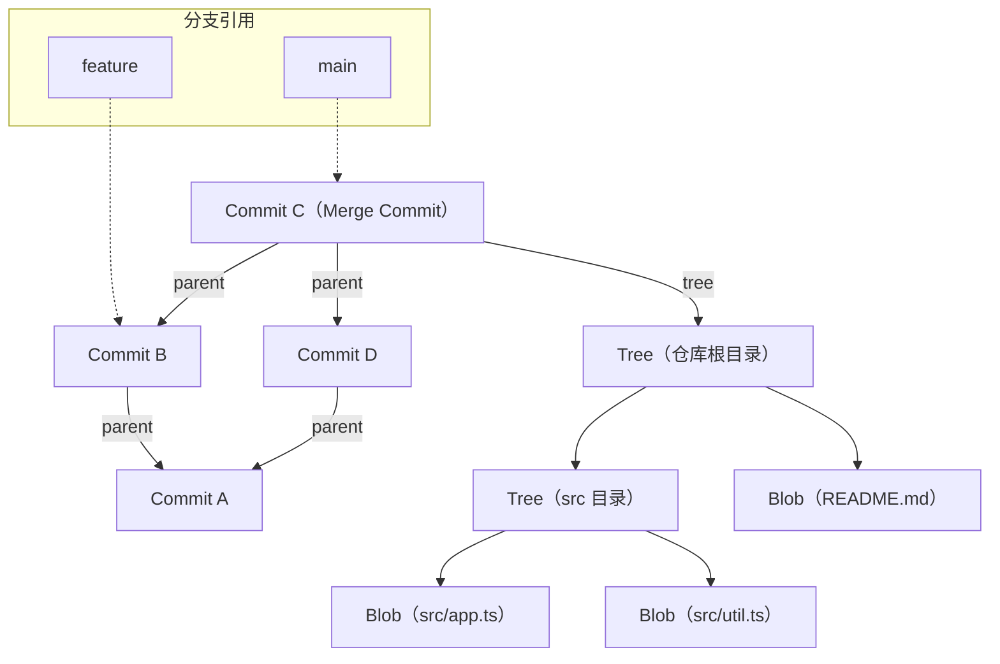
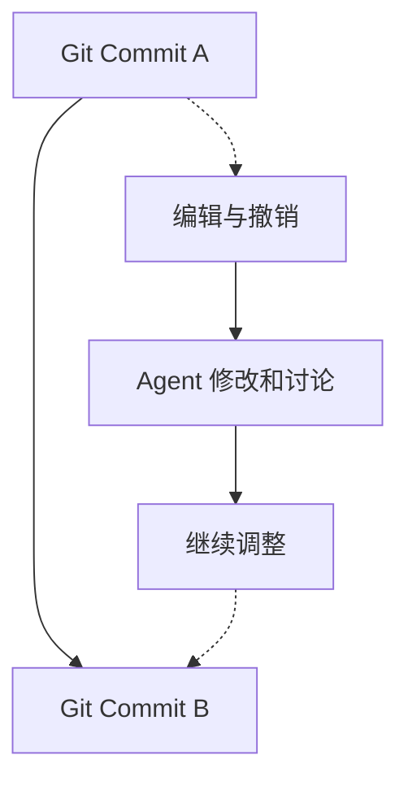
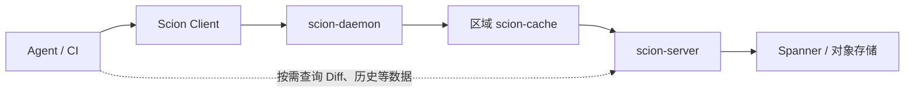

如果现在要给一个项目挑选版本控制工具，可能多半还是 Git。它足够稳定，生态也足够成熟，而且几乎所有主流代码托管平台和 CI 服务都支持它。

然而，代码编写逐渐由 Agent 接管，代码修改的频率与规模也可能随之增长。一次重构可能涉及几十个文件、上千行 Diff 更改。Agent 实施完第一版，测试失败后继续调整实现，最后补上测试……等到我们检查 Diff、整理 Commit 时，看到的通常只是当前改动和保留下来的版本，之前撤销过的几轮尝试并不会出现在提交历史中。

但这并非 Git 自身的问题。Git 原本就不负责保存每一次编辑，也不需要知道某段代码经历了多少轮讨论。随着自动化开发任务的增多，我们开始遇到一些新的需求，包括频繁整理 Commit、回溯开发过程，以及降低大量 Agent 并发访问仓库时的资源开销。近年来受到关注的 Jujutsu、DeltaDB 与 Anthropic Scion，分别从不同方面尝试解决这些问题。

## 一、从集中式版本控制到 Git

在 Git 出现之前，版本控制已经发展了几十年。早期有 SCCS、RCS 这样的工具，后来又出现了 CVS 和 SVN。SVN（Subversion）采用集中式版本控制架构，代码历史主要保存在服务器上，团队成员从服务器获取代码，再把修改提交回去。这种方式便于集中管理，本地也能进行 Diff 等操作，但创建新的版本并提交到仓库通常需要连接服务器。

2005 年，Linux 内核社区开始开发 Git。由于内核开发需要处理大量补丁、分支和合并，开发者也需要在各自的机器上独立工作，Git 因此采用了分布式架构。每个完整的本地仓库都可以保存历史、创建 Commit、比较版本，也能在没有网络连接时继续工作。

Git 在内部采用了内容寻址的对象模型。Blob Object 存储文件内容，Tree Object 记录目录结构及其包含的对象引用，而 Commit Object 则保存指向顶层 Tree Object 的引用、父 Commit 的引用，以及作者、提交时间和 Commit Message 等元信息。Commit 之间的父子关系构成了 DAG（有向无环图），我们平时看到的分支名，实际上是指向某个 Commit 的引用。



<p class="figure-caption">上图把分支引用、提交之间的父子关系，以及 Commit → Tree → Blob 的对象层级画在一起，其中对象层级只展示了一个提交。</p>

有了这些设计，开发者可以在本地完成相当多的操作，再通过远程仓库交换 Commit。如今，GitHub、CNB 等代码托管平台进一步扩展了 Git 的协作能力，提供了 Pull Request、CI/CD 等功能，使代码审查、自动化测试和持续交付逐渐融入日常开发流程。

在一些需要集中管理的场景里，SVN 的工作方式至今仍有优势。Git 能够逐渐普及，与它提供的本地能力、分支合并方式以及软件社区的协作需求也密切相关。

## 二、Git 的工作区与提交整理

如今，我们或许已经非常习惯~~看 AI~~进行下列操作。

```bash
git add .
git commit -m "refactor: replace AI slop with more AI slop, maybe fix a few bugs"
git push
```

`git add` 将指定的文件修改加入暂存区，`git commit` 根据暂存区的内容创建 Commit，`git push` 则将本地 Commit 及相关引用更新推送到远端。我们可以根据实际需要，决定哪些修改应当包含在同一个 Commit 中。

例如，在修复 Bug 时顺手调整了格式，我们可以用 `git add -p` 只挑选一部分 Hunk，避免把无关改动混进同一个 Commit。平时写代码时，这样做没什么问题。不过，一旦需要反复整理已经创建的几个 Commit，操作就会复杂起来。我们可能需要使用 `rebase -i`、`reset`、`cherry-pick` 等命令调整历史，如果操作过程中出现问题，有时还得借助 `reflog` 找回之前的提交。~~（但或许也还好，因为相信在今天，我们都直接交给 Agent 去做了。）~~

在 Agent 参与开发之后，按任务执行顺序产生的 Commit，也未必适合直接合并到主分支。有些修改可能属于同一项功能，需要合并成一个 Commit。有些修改虽然由同一个任务产生，却涉及不同的模块，最好分别提交。还有一些修复需要移动到更早的 Commit 中，保持历史的逻辑关系。

Git 能够完成这些操作，但在反复整理 Commit 时，我们需要同时处理工作区、暂存区、HEAD、分支引用以及 Rebase 带来的历史变化。当修改频繁、Commit 数量较多时，整个过程也会变得更加繁琐。

## 三、Jujutsu 的提交管理方式

[Jujutsu](https://docs.jj-vcs.dev/latest/) 通常简称 `jj`。它的开发早于这轮 AI Agent 热潮，也支持直接使用 Git 作为存储后端。我们仍然可以与现有 Git 仓库协作，只是本地操作需要适应另一套习惯。

在 Jujutsu 中，没有 Git 那种需要显式操作的暂存区。工作区本身就对应一个可修改的 Commit。我们修改文件后，Jujutsu 会在执行相关命令时对工作区进行快照，省去了反复 `git add` 的步骤。不过，这种自动快照并不等于每次按键都会立即创建一个永久保存的版本。

Jujutsu 还引入了一个重要概念，Change ID。Git 使用 Commit ID 标识具体的 Commit。只要修改 Commit 的内容或者父 Commit，对应的 Commit ID 通常就会改变，这也是 Rebase 之后会出现一串新 Commit ID 的原因。Jujutsu 则在 Commit ID 之外引入相对稳定的 Change ID。同一项变更多次修改后，我们仍然可以通过 Change ID 追踪它，而不必每次重新查找新生成的 Commit ID。

换句话说，我们可以把更多注意力放在“这项变更”本身，而不必总是记住它每一次修改后对应的 Commit Hash。当然，Change ID 的稳定性也有具体规则，拆分、复制或改写时仍需要了解相关行为。

Jujutsu 中的常用命令：

```bash
jj status       # 查看工作区状态
jj log          # 查看 Commit 历史
jj diff         # 查看当前变更
jj split        # 拆分变更
jj op log       # 查看 Operation Log
jj undo         # 撤销最近一次可撤销的仓库操作
```

平时使用 Git 时，我们主要关心 Commit History，也就是代码版本之间的关系。但在整理历史的过程中，仓库本身同样会经历一连串状态变化。例如执行 Rebase、拆分 Commit、调整父提交关系等操作，都可能改变仓库当前的状态。

Jujutsu 的 Operation Log 记录的正是这些仓库操作，`jj undo` 也建立在它之上。如果刚刚完成一次 Rebase，却发现结果不符合预期，我们可以通过 Operation Log 找到之前的仓库状态，而不必完全依赖 Commit ID 或其他引用手动恢复。不过，它并不等于编辑器中的无限撤销，也无法恢复所有外部操作产生的副作用。

Jujutsu 还允许把冲突保存在 Commit 中，留到后面处理。对于需要频繁 Rebase、整理堆叠提交的情况，这样可以避免每次遇到冲突就中断整个操作。但冲突最终仍然需要解决，包含冲突的代码也不会因此自动变成可以正常构建的版本。

Jujutsu 对本地工作流的调整相当明显。即使没有 Agent，频繁整理 Commit 的开发者也可能从中受益。不过，使用 Git 后端并不代表两套命令可以随意混用，Bookmarks、历史改写和远端同步的语义仍然需要额外熟悉。

## 四、DeltaDB 与提交之间的编辑历史

Zed 的 [Delta](https://zed.dev/blog/introducing-delta) 把 Agent 会话、代码修改与多人协作放在同一个界面里。它所采用的 DeltaDB 则在 Git Commit History 之外，记录开发过程中发生的编辑操作。

我们通常会在一项工作完成后创建 Commit。Git 可以告诉我们某次提交改了哪些文件、与上一个版本有什么差异，配合 PR 也能保存审查意见。但从打开文件开始，到最终提交之前，我们可能试过好几种实现，改了又撤销，期间还和其他人或 Agent 讨论过。除非主动记录，这些过程一般不会完整保存在 Git 的 Commit History 中。

DeltaDB 希望把这段过程也保存下来。它在 Git 之外增加了一层以 Delta 为单位的编辑记录，原本的 Commit、Push 和远程仓库仍然保留。每次编辑都可以记录对应的修改内容、作者及其所依据的版本，并同步到其他协作者。相关对话和评论也可以与代码变更保存在同一份历史中。

要实现实时协作，还需要处理并发编辑。假设两个人从同一份文本开始修改，其中一个人在开头插入几个字符，另一个人也在相同位置编辑。等修改通过网络传到另一端，“第 0 个字符之前”可能已经指向不同的内容。如果简单按照当前字符偏移应用修改，就很容易出现冲突。

DeltaDB 使用 CRDT（Conflict-free Replicated Data Types）处理这类问题。它会记录每次编辑所依据的版本，通过因果关系确定不同操作之间的依赖，再使用 Fragment Index 等结构定位文字在不同版本中的位置。

不同协作者接收修改的顺序即使不一样，只要最终获得相同的编辑操作，并遵循同一套冲突处理规则，各自就能得到一致的文档内容。DeltaDB 还使用结构共享等方式，让不同版本复用未发生变化的数据，避免每次编辑都复制一份完整文档。



<p class="figure-caption">上图仅展示 Git Commit 之间可能存在的编辑过程，并非 DeltaDB 实际的数据结构。</p>

这种记录方式对代码审查也有帮助。例如，某个 Agent 修改了一个函数，审查者发现其中的实现存在疑点。如果只能看到最终的 Diff 和 Commit Message，可能还需要重新查找任务描述、执行记录，才能了解修改的背景。而在 DeltaDB 中，编辑记录可以关联到产生它的会话，让审查者直接查看相关讨论和修改过程。

不过，记录更多信息也会产生新的问题。编辑历史和 Agent 对话可能包含不适合长期保存的内容，团队还需要处理访问权限、同步故障、历史保留以及数据清理。CRDT 可以帮助不同副本保持一致，但它无法判断一段代码在业务逻辑上是否正确，也不能代替编译、测试和代码审查。

至于这些记录能否真正降低协作成本，就与实际项目中有关了。

## 五、Anthropic Scion 的服务端架构

2026 年 10 月 13 日，Anthropic 发布了 [《Redesigning source control at Anthropic》](https://www.anthropic.com/research/redesigning-source-control)，介绍了他们自研的版本控制系统 Scion，以及在五个月内将内部 Monorepo 从 Git 迁移过去的经历。

2026 年 5 月，Anthropic 内部平均每天合并约 2,500 项代码变更，到了 9 月，这一数字已经超过 30,000 项。与此同时，主分支历史接近 100 GB，压缩后的 Working Copy 超过 25 GB。仅 CI 每天进行的代码 Checkout 就约有 2,500 万次，还没有算上 Agent 沙箱和其他开发环境。

当然，这种规模对绝大多数项目来说都十分遥远。Git 本身也提供了 Shallow Clone、Sparse Checkout、Partial Clone 等方案，大型团队还可以借助 Git 镜像和预制仓库快照减少重复下载。Anthropic 也尝试过这些办法，甚至运行了数百台内部 Git 镜像。但随着代码变更和 Checkout 次数持续增长，维护这些基础设施的成本也越来越高。

Scion 的设计很大程度上建立在 Anthropic 自身的工作方式上。Git 的分布式架构允许完整的本地 Clone 独立完成历史查询、Diff、Merge 等操作，即使离线也能正常工作。但 Anthropic 的大量客户端是始终在线的 Agent 和 CI Job，它们未必需要保存完整仓库历史，却可能为了查询一次变更、获取几个文件而反复准备仓库。

Scion 因此把不少工作移到了服务端。创建 Changeset、执行 Merge、Rebase 和查询历史等操作，都可以交给服务器处理。客户端主要负责本地文件、文件变化监控和有限的对象缓存，需要什么再从服务端获取。CI 如果只需要两个版本之间的 Diff，也可以直接请求 API，不必先做一次完整的 Checkout。

在数据组织上，Scion 的 Changeset 也与 Git Commit 不完全一样。Git Commit 指向整棵目录树，而 Scion 的 Changeset 主要记录相对第一个父 Changeset 发生变化的文件，并保存指向文件内容的内容寻址引用。对于 Blame、文件历史等查询，Scion 还会通过额外的数据结构建立索引，并根据需要进行计算。

这样一来，创建一次小修改时，相关计算成本就不必随着整个仓库的规模一起增长。Scion 也不需要为每次修改生成和维护 Git 使用的 Packfile。



<p class="figure-caption">上图简化了 Scion 的 Checkout 与 API 查询路径；实际运行时，本地 Daemon、区域缓存与 Server 之间还存在缓存命中、对象读取等过程。</p>

迁移完成后，Anthropic 披露的 Scion 基础设施在 CPU 和内存资源需求方面，相比原先的 Git 镜像架构缩减到约二百分之一，CI 也节约了约 25% 的 CPU 容量。这些都是 Anthropic 在自身仓库规模下测得的结果，不能直接用于估算其他项目迁移后的收益。

这些性能改善背后也有代价。

Git 很重要的一个优点就是离线可用，本地仓库可以独立完成大量操作。而 Scion 选择依赖持续可用的服务端，以增加网络和中心服务依赖为代价，减少客户端需要保存的数据，并让服务端能够按需扩展。

如果仓库规模不大，也没有如此密集的 CI 和 Agent 访问需求，改用这类架构未必能抵消额外的服务端维护成本。网络延迟、服务可用性以及离线工作能力的变化，同样是需要考虑的问题。

Scion 目前只供 Anthropic 内部使用，不能像 Git 或 Jujutsu 那样可以直接下载安装。Anthropic 也明确表示，它并不适合作为通用场景下的 Git 替代品。除了版本控制本身，迁移还涉及代码审查、搜索、CI 和权限管理等系统。Anthropic 为此开发了 Antique 等配套工具，实际改动远不只是替换一套 CLI……

## 六、GitLab 的 Git 兼容改进路线

GitLab 则尝试在保留 Git 兼容性的基础上改进后端架构。

2026 年 6 月，GitLab 公布了正在开发的 [Next-Gen SCM](https://about.gitlab.com/blog/scaling-git-for-the-agentic-software-factory/)，并在 8 月进一步介绍了架构和早期性能测试结果。10 月 13 日，GitLab 又发表了相关文章，讨论如何在 Agent 的工作负载下改进 Git 服务端。

Next-Gen SCM 希望在保留现有的 Git 协议和协作生态的同时，去重新组织服务端存储与计算。对于只需要少量文件或者部分历史数据的 Agent，可以通过专门的 API 按需获取信息，减少反复 Clone 大型仓库的开销。而服务端则可通过共享对象存储和可横向扩展的计算服务，提高大量并发请求下的处理能力。

实际上，大型 Monorepo 早就在面对类似的问题。Google 的 Piper、Meta 的 Sapling 等系统都探索过面向大规模代码仓库的管理方式，Scion 也借鉴了其中的经验。AI Agent 的出现加快了部分组织代码变更规模的增长，但并不是这些架构问题产生的唯一原因。

Jujutsu、DeltaDB、Scion 和 GitLab 的方案也不存在统一的替代顺序。Jujutsu 主要调整本地操作模型，DeltaDB 在 Git 之外保存更完整的编辑历史，Scion 则针对特定工作负载重新设计服务端和数据结构。GitLab 希望在保留 Git 兼容性的前提下改善后端的扩展能力。这几种方案面对的情况差得很远，Anthropic 的仓库一天要合并三万项变更，而 Jujutsu 面向的往往是一个人整理刚写完的几个提交。它们服务的使用者本身就不相同。

## 后记

从早期的集中式版本控制到 Git 的分布式协作，版本控制系统的发展始终与软件开发的实际需求密切相关。Git 已经能够可靠地管理代码历史，并形成了成熟的协作生态。如今，随着 LLM 能力的提升，Coding Agent 开始承担越来越多原本由开发者完成的编码任务，版本控制要承受的压力也随之变大。

过去，代码的编写速度往往受到开发者时间和精力的限制。现在，Agent 可以持续修改代码、运行测试、修复问题，多个 Agent 甚至能够并行处理不同的任务。代码产出的速度提高了，但我们能够审查、理解和验证的代码量并不会自动以相同的速度增长。大量并行修改还会增加冲突处理、变更追踪和 CI 验证的压力。

这也是当前版本控制系统变化的一个重要背景。Git 的 Commit History 并不包含开发过程中的全部信息，随着自动化任务增多，如何整理持续产生的修改、追踪代码与任务之间的关系，以及避免仓库操作成为大规模开发的性能瓶颈，都开始受到更多关注。

当然，更先进的版本控制系统也无法直接保证软件质量。即使我们能够记录每一次编辑、恢复任意一次仓库操作，或者让数千个 Agent 高效访问同一个 Monorepo，也不代表产生的代码一定正确。编译、测试、代码审查和项目工程判断仍然是软件开发中不可缺少的部分。

Git 之外，版本控制正在改变的，不只是保存代码的方式，还有我们组织修改、追溯开发过程，以及支撑大规模协作的方式。随着 Agent 进一步参与软件开发，这些需求可能还会继续变化。Git 是否会被新的系统取代很难判断，但围绕版本控制所进行的这些探索，或许已经可以让我们能够重新审视现有工作流中习以为常的设计。

> [!NOTE]
> 本文主要根据截至 2026 年 11 月公开的内容编写，部分项目仍在快速迭代中。个人理解和能力有限，若发现任何事实错误或技术上的问题，欢迎在评论区指出、交流与指正，也十分欢迎不同的观点和补充。

---

## 参考资料

1. [Git 官方文档 — A Short History of Git](https://git-scm.com/book/en/v2/Getting-Started-A-Short-History-of-Git)
2. [Git 官方文档 — Git Internals — Git Objects](https://git-scm.com/book/en/v2/Git-Internals-Git-Objects)
3. [Jujutsu 官方文档 — Git comparison](https://docs.jj-vcs.dev/latest/git-comparison/)
4. [Jujutsu 官方文档 — Tutorial](https://docs.jj-vcs.dev/latest/tutorial/)
5. [Zed — Introducing Delta（2026-08-12）](https://zed.dev/blog/introducing-delta)
6. [Delta — DeltaDB: The Future of Version Control（2026-10-15）](https://delta.dev/blog/future-of-version-control)
7. [DeltaDB — Under the hood](https://delta.dev/deltadb)
8. [Anthropic — Redesigning source control at Anthropic（2026-10-13）](https://www.anthropic.com/research/redesigning-source-control)
9. [GitLab — Git was built for humans — agents need an upgrade（2026-08-26）](https://about.gitlab.com/blog/gitlab-next-gen-scm/)
10. [GitLab — Scaling Git for the agentic software factory（2026-10-13）](https://about.gitlab.com/blog/scaling-git-for-the-agentic-software-factory/)
