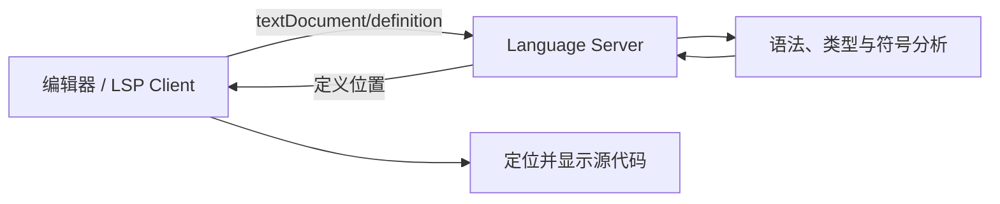
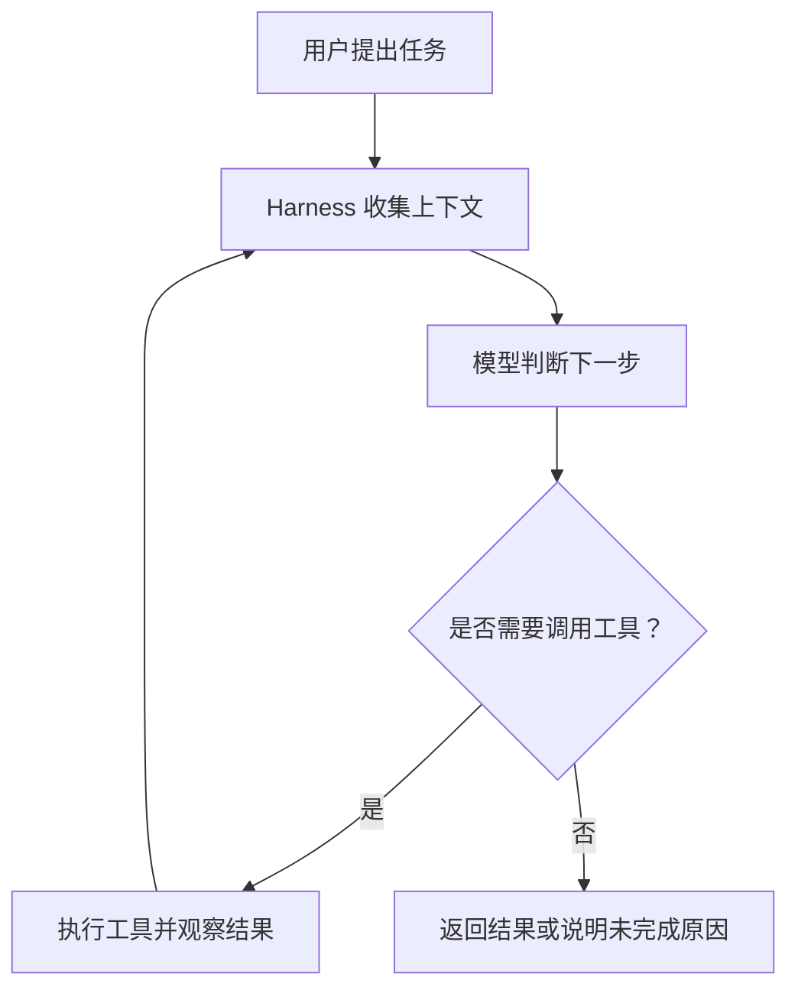
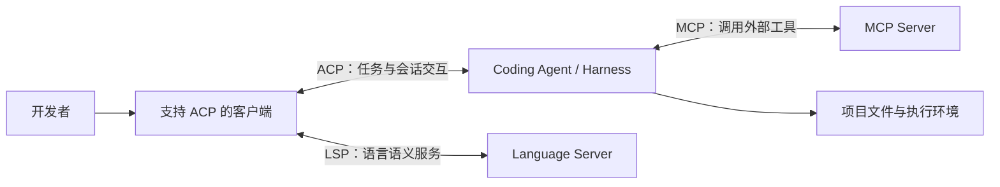
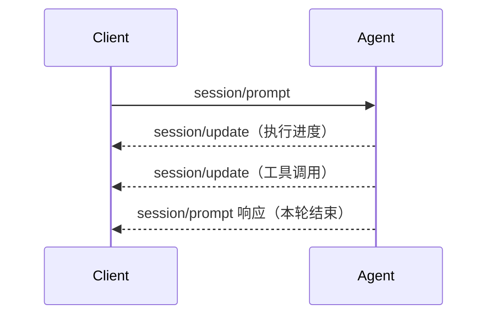
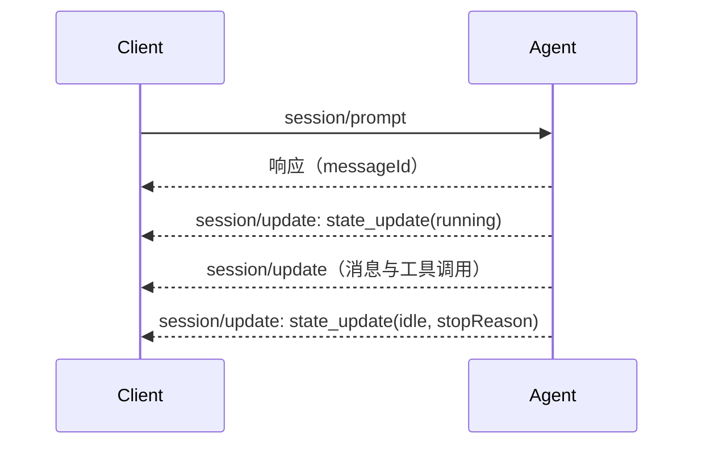
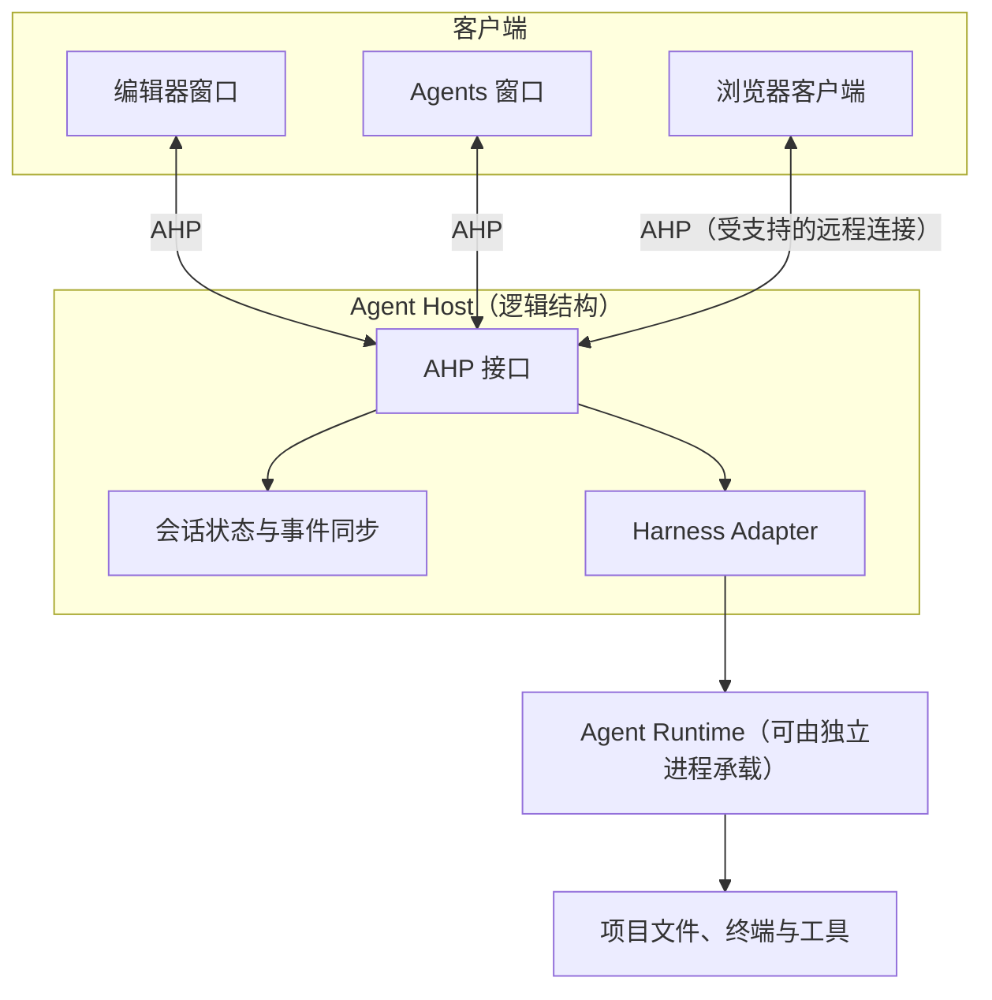
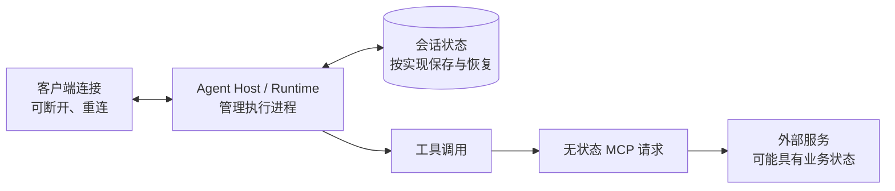
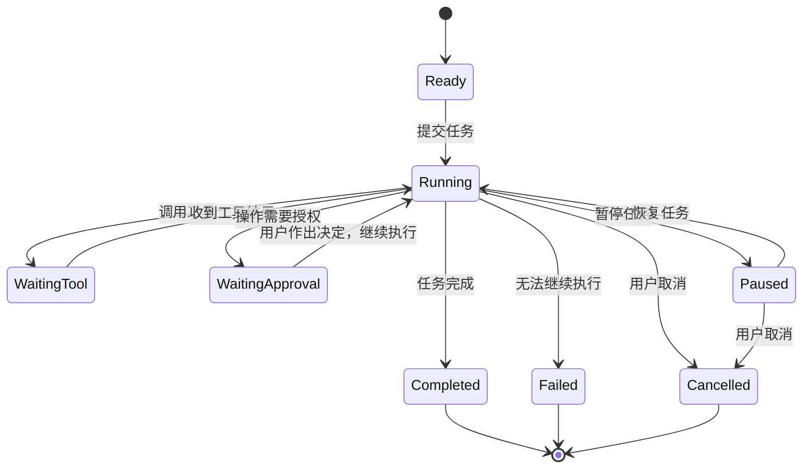

> [!NOTE]
> 这篇文章是早上一时兴起写下的。写着写着才发现，已经许久没有维护的博客竟然还不支持 Mermaid 渲染，于是临时让 Agent 补上了这一功能，不过实际效果仍不尽如人意。
>
> 最近忙于其他几个项目的开发，加上即将要参加校内部分科目的结课考试，实在抽不出太多时间对博客进行全面重构。也许等日后有了空闲，还是打算基于 Neoverse-UI 和更新的技术栈，重新设计并重写整个博客项目。或许可以期待……一下？☺️

> 从 2016 年 LSP 的出现，到近年来 MCP、ACP 等协议的发展，再到如今逐渐成熟的 Coding Agent，开发工具已经与十年前有了很大的不同。我们不再局限于传统的 IDE，也可以在终端、桌面客户端甚至浏览器中，让 Agent 帮忙完成部分开发工作。与此同时，这些工具背后的架构也在发生变化，原本集成在一起的语言分析、工具调用和任务执行等功能，逐渐有了各自独立的实现。

## 引言

在 VS Code 中编写 Go、使用 Neovim 编辑 Rust 时，代码补全、定义跳转和语法诊断通常已经是开发环境的一部分。不同编辑器的操作方式可能差别很大，但它们都可以借助语言服务器获得类似的语言分析能力。对日常使用来说，我们未必需要知道这些功能究竟由哪个进程完成。

AI 编程工具的普及带来了另一类工作方式。Claude Code、Codex 等 Coding Agent 可以在终端或其他客户端中读取项目、修改文件、运行测试，并根据执行结果继续调整代码。与之相伴的交互界面也不再局限于编辑器插件——既有用于一般 AI 交互的 ChatGPT Desktop，也有 Zed 团队推出的 [Delta](https://zed.dev/blog/introducing-delta)——一个围绕 Agent 会话、代码变更与多人协作设计的独立应用。它们的用途并不完全相同，却都说明 AI 与代码的交互不一定要从传统编辑器中的一块聊天面板开始。

这些变化还涉及一个更实际的问题，那就是当我们交给 Agent 一项需要持续执行的任务时，如果关闭当前窗口、切换设备，或者让另一位开发者一起查看执行过程，原来的任务会发生什么？它能否继续运行，又由谁负责保存进度？十年前，语言服务器所解决的是编辑器与语言分析工具之间的重复适配。今天，Agent 的接入、会话管理和运行环境也开始遇到相似的工程问题。

## 一、从集成式 IDE 到语言服务器

早期的集成开发环境（IDE）往往将文本编辑、代码分析、补全、调试与构建工具整合在同一个产品中。这种方式让面向特定语言的 IDE 能够充分利用编译器、类型系统和工程模型，提供相当完整的开发体验。问题主要出现在需要同时支持多种语言和多种编辑器时。

假设有 5 种编程语言、4 款编辑器，如果每一种语言都要针对每一款编辑器编写专门的集成代码，最直接的方案便可能涉及 20 组适配。实际项目通常会复用插件、共享库和已有工具，并不会机械地重复这么多份工作，但语言能力与编辑器接口紧密绑定，仍然会增加移植和维护成本。

以 Go 为例，即使已有工具能够完成类型检查和符号分析，另一款编辑器也未必能直接复用这些能力，还要处理它自己的插件 API、事件模型和数据格式。相比为每个组合分别开发插件，让语言工具通过统一的接口提供服务，是更便于复用的做法。

2016 年 6 月，Microsoft、Red Hat 与 Codenvy 共同推动的 Language Server Protocol（LSP）开始走向开放标准化。LSP 将编辑器视为客户端，将提供语义分析的程序视为语言服务器。两端使用 JSON-RPC 交换消息。编辑器负责文档操作和结果展示，服务器则根据语言自身的规则完成分析。

例如，我们在编辑器中执行“跳转到定义”，客户端可以发送一条 `textDocument/definition` 请求：

```json
{
  "jsonrpc": "2.0",
  "id": 1,
  "method": "textDocument/definition",
  "params": {
    "textDocument": { "uri": "file:///workspace/main.go" },
    "position": { "line": 9, "character": 4 }
  }
}
```

其中，`method` 表示希望使用的语言服务，`position` 指向当前文档中的位置（行号与字符偏移均从零开始；`character` 的计数单位取决于协商的位置编码，未协商时默认使用 UTF-16）。语言服务器收到请求后，可以利用语法树、类型信息或符号索引找到定义位置，再将结果返回给编辑器。整个过程可以概括为：



编辑文档时，客户端还可以使用 `textDocument/didChange` 报告内容变化。服务器则通过 `textDocument/publishDiagnostics` 等通知提供诊断信息。协议定义了消息及其语义，却不要求服务器采用特定的编译器前端，也不限定编辑器使用哪种 UI 技术。因此，诸如 `gopls`、`rust-analyzer` 这样的语言服务器能够被多种客户端使用，而无须为每一款编辑器重新实现全部语言分析逻辑。

这种复用并不意味着所有 LSP 客户端都有相同的功能。不同实现支持的协议特性、编辑器提供的交互方式，仍然会影响最终体验。之后出现的 Debug Adapter Protocol（DAP）也沿用了类似思路，让编辑器通过统一接口与不同调试器交互。语言分析、调试与编辑界面可以分别发展，再通过协议组合成完整的开发环境。

## 二、当代码智能不再局限于语言分析

语言服务器提供的大部分能力，建立在编程语言的语法、类型系统与语义规则之上。类型检查器可以根据规则判断表达式是否合法，符号分析器可以根据作用域与引用关系定位定义。它们的实现并非没有复杂性，但任务目标通常相对明确，结果也有具体的程序语义作为依据。

大语言模型进入开发流程后，我们开始使用自然语言描述更完整的任务。例如，“为这个 Go 服务增加限流功能，并补充相应测试”。要完成它，工具可能需要阅读路由定义、检查已有中间件、修改配置与代码、运行测试，再根据报错继续调整。这里已经不只是针对某个文档位置给出一次分析结果，而是在围绕目标执行一系列操作。

也正因如此，能够生成代码的模型并不直接等于 Coding Agent。模型负责生成内容或判断下一步操作，而项目上下文、工具调用、命令执行、权限确认和错误处理，通常由外层的 Agent Harness（或 Agent Runtime）组织。一个简化的执行过程如下：



这只是用于理解的流程图，并非所有 Agent 都采用同一套循环。实际运行时还可能包含并行工具调用、子 Agent、上下文压缩和任务恢复等机制。不过，它足以说明两类工具的差异——语言服务器通常为明确的编辑操作提供分析结果，Agent 则需要自己组织多步执行，并对过程中出现的新情况作出反应。

当 Agent 逐渐能够处理完整的开发任务，开发工具也就不只是需要一个模型 API，还需要为这套执行系统提供文件访问、命令运行、状态展示与用户交互。这些功能应该放在哪里、如何复用，成为新的集成问题。

## 三、AI 的兴起与工具调用的标准化

2024 年 11 月，Anthropic 发布 Model Context Protocol（MCP），尝试统一 AI 应用与外部数据、工具之间的通信方式。此前，不同 AI 应用接入 GitHub、数据库、文件系统或其他服务，通常需要分别实现专有接口。应用和服务越来越多，重复集成的问题也随之增加。

MCP 采用 Host、Client 与 Server 的架构。Host 管理与 MCP Server 的连接，Server 则可以提供 Tools、Resources 和 Prompts 等能力。以工具调用为例，假设某个服务提供了名为 `search_code` 的工具，请求的核心 JSON-RPC 结构可以写成如下形式：

```json
{
  "jsonrpc": "2.0",
  "id": 2,
  "method": "tools/call",
  "params": {
    "name": "search_code",
    "arguments": { "query": "RateLimiter" }
  }
}
```

这里省略了 2026-07-28 版 MCP 规范对请求元信息和传输的具体要求，仅展示 `tools/call` 的主要字段。工具内部可以使用 `ripgrep`、数据库索引或远程 API，MCP Client 只需按照协议描述工具和参数，并处理返回的结果。与 LSP 类似，MCP 更关注的是能力如何被其他软件使用，而不是具体功能的内部实现。

不过，MCP 主要解决的是 AI 应用与外部服务的集成。它并不规定 Coding Agent 应该如何规划任务，也不负责统一不同 Agent 的执行循环、上下文管理或会话界面。因此，即使多个 Agent 能够调用同一组 MCP 工具，也不代表我们可以用同一种方式控制它们。

这一点在不同的使用形态中尤为明显。终端 Agent、IDE 内的智能编程功能、独立桌面应用和面向协作的 Web 界面，可能都需要操作项目文件和工具，但呈现执行过程、接收权限确认及管理任务状态的方式并不一样。MCP 减少了工具接入方面的重复工作，却没有统一 Agent 与这些客户端的交互方式。

## 四、2025：AI Agent 与客户端的解耦

2025 年 8 月，Zed 发布 Agent Client Protocol（ACP），并与 Google 合作，以 Gemini CLI 作为初始参考实现。它希望让 Coding Agent 能够通过共同的协议接入兼容的客户端，而不必为每一款编辑器或客户端分别开发完整的交互集成。

ACP 与 LSP 在设计思路上有相似之处，只不过通信的另一端由 Language Server 换成了 Agent。在典型的 ACP 交互中，Client 负责展示会话、工具调用进度和权限请求，Agent 则保留自己的模型选择、工具执行和上下文管理策略。客户端能够使用协议中的结构化信息更新界面，不必从终端字符流中猜测哪些内容是日志、文件修改或者需要审批的操作。

以 ACP v1 为例，客户端先通过 `initialize` 协商协议版本与能力，再调用 `session/new` 创建会话。提交任务时，可以发送 `session/prompt`：

```json
{
  "jsonrpc": "2.0",
  "id": 2,
  "method": "session/prompt",
  "params": {
    "sessionId": "sess_abc123",
    "prompt": [
      {
        "type": "text",
        "text": "为 Go 服务添加限流，并运行相关测试"
      }
    ]
  }
}
```

这条消息假定会话已经创建，`sessionId` 为示意值。Agent 执行过程中，可以通过 `session/update` 向客户端报告消息与工具调用状态。需要用户授权时，也可以通过相应的请求让客户端展示操作内容并获取决定。使用者看到的是经过组织的任务过程，而不必依靠某个特定 Agent 的专有 UI。

需要区分的是， **模型和 Agent 并不是同一个层次**。即使两套 Agent 使用相同模型，也可能采用完全不同的工具策略、上下文组织方式和权限机制。ACP 并不试图把这些差异统一为一种实现，而是让客户端能够通过协议与不同 Agent 交互。

LSP、MCP 和 ACP 可以同时出现在一套开发环境中，而且彼此并不是替代关系。



LSP 负责语言服务，MCP 负责接入外部能力，ACP 负责 Agent 与客户端之间的交互。它们出现于不同阶段，也分别处理不同问题。

## 五、2026：AI Agent 的会话与任务管理

2026 年，Agent 的使用场景开始进一步考验传统的请求响应模式。以一个数据库访问层重构任务为例，Agent 可能先修改代码，再执行测试，遇到错误后重新分析。这期间，我们也可能补充需求、取消某项操作，或者暂时切换到其他工作。

在 ACP v1 中，`session/prompt` 通常要等当前执行轮次结束后才返回。客户端可以在等待期间接收 `session/update`，但一次 Prompt 请求的完成与这一轮 Agent 工作的完成关联得比较紧密。如果任务持续运行，或者 Agent 在没有新 Prompt 的情况下自主继续工作，这种表示方式就会显得不够灵活。

2026 年 7 月公开的 ACP v2 Draft 对此作出了调整，`session/prompt` 的成功响应表示 **用户消息已经被插入会话**，并返回对应的 `messageId`。后续执行状态、工具调用和任务完成，则通过 `session/update` 报告。它不是简单地确认网络请求已收到，也不是告诉客户端任务已经结束。

下面用时序图展示两种方式的主要区别，省略初始化、身份验证与部分通知：

**ACP v1：Prompt 请求在本轮执行结束后返回。**



**ACP v2 Draft：消息插入与执行完成分别报告。**



> [!NOTE]
> 第二幅图仅用于说明消息类型，不表示响应和更新通知必须严格按图中的顺序到达。ACP v2 允许消息更新早于 `session/prompt` 响应到达，客户端需要依靠 `messageId` 等标识关联消息。其中，`idle` 表示当前没有正在执行的前台工作，并不意味着后台任务已经全部停止。

除了 Prompt 的生命周期，v2 还重新整理了消息流、工具调用更新和文件变更等表达方式。客户端可以更明确地区分“消息已提交”“Agent 正在工作”“等待用户操作”以及“前台工作已结束”。对于需要长时间运行或不断接收新输入的 Agent，这些状态比单纯判断某个请求是否返回更加实用。

不过，协议允许 Agent 在一次 Prompt 请求结束后继续更新状态，并不意味着它已经具备断线恢复或持久运行能力。这些仍然取决于 Agent Runtime 如何保存会话、管理进程和处理失败。**ACP v2 截至本文写作时仍处于 Draft 阶段**，上述设计应以对应版本的官方文档为准。

## 六、从编辑器窗口到独立运行的 Agent

Agent 会话和单次请求可以分别管理之后，还有一个问题需要处理，执行任务的进程由谁维护？如果 Agent 依附于某个编辑器窗口的扩展进程，那么即使协议允许异步更新，窗口退出时仍可能直接终止运行中的任务。

2026 年 8 月，VS Code 团队介绍了 Agent Host 架构和 Agent Host Protocol（AHP）。对于采用这一架构的会话，Agent Harness 与会话状态由独立的 Agent Host 进程管理，不再依赖最初创建会话的编辑器窗口。编辑器窗口、Agents 窗口或受到支持的远程客户端，可以连接到同一个 Host 查看和操作会话。不过，仍有部分会话运行在传统的 Extension Host 中，并非所有 Agent 会话都已迁移到新架构。



对于受支持的会话，关闭最初打开项目的编辑器窗口，不再必然终止 Agent。多个客户端也能够共享 Host 管理的会话状态，而不是各自保存一套互不相关的执行记录。AHP 侧重的是 Host 与客户端之间的会话同步和控制，因此与直接连接 Agent 的 ACP 在职责上有所不同。两者也不是同一个协议的不同版本。

如果需要单独运行 Agent Host，VS Code 提供了相应的命令（具体可用性取决于版本和安装环境）：

```bash
code agent host
```

> [!WARNING]
> 这里的“独立运行”需要区分几种情况。对于 VS Code 管理的本地 Host，关闭项目窗口可以继续执行任务，但**退出整个 VS Code 应用**并不等同于保留该 Host。独立启动或部署在远程的 Host，也仍然依赖其进程和执行环境持续运行。客户端断开连接，更不代表所有由客户端提供的工具还能继续使用。

与此同时，Agent 的使用界面也在发生变化。传统 IDE 可以增加 Agent 面板、任务管理和变更审查功能，但并不是所有新工具都会沿用“编辑器 + 聊天侧栏”的设计。Zed 团队于 2026 年 8 月发布的 [Delta](https://zed.dev/blog/introducing-delta) 就将会话、代码修改与多人协作放在同一个工作空间中，支持围绕同一段代码变更继续讨论和审查。它还尝试让终端中已有的 Agent 会话与协作界面保持同步。

Delta 采用的 DeltaDB 与 VS Code 的 Agent Host 并不是同一套架构，也不适合将它直接归类为 ACP 或 AHP 的客户端案例。不过，它确实提供了另一个观察角度，即当我们主要通过任务描述、执行反馈和代码审查来参与开发时，交互界面未必需要始终围绕文件树和文本编辑器组织。

## 七、无状态的工具，有状态的智能体

Agent 越来越需要管理持续存在的会话，但 MCP 在 2026 年 7 月 28 日发布的新规范中，却转向了无状态的协议核心。这种变化初看似乎相反，实际上处理的是不同问题。Agent 需要保留任务进度，远程工具服务则希望每个请求尽可能独立，便于通过普通 HTTP 基础设施部署和扩展。

新的 MCP 核心不再要求原先的协议级初始化握手和会话标识，而是让请求包含所需的协议信息。下面仅摘录一次工具调用的 HTTP 报文结构，用来说明其表达方式。其中省略了认证、报文体长度等传输细节，不应直接当作完整的生产请求使用：

```http
POST /mcp HTTP/1.1
Host: mcp.example.com
Content-Type: application/json
Accept: application/json, text/event-stream
MCP-Protocol-Version: 2026-07-28
Mcp-Method: tools/call
Mcp-Name: search_code

{"jsonrpc":"2.0","id":2,"method":"tools/call","params":{"name":"search_code","arguments":{"query":"RateLimiter"},"_meta":{"io.modelcontextprotocol/protocolVersion":"2026-07-28","io.modelcontextprotocol/clientInfo":{"name":"my-agent","version":"1.0"},"io.modelcontextprotocol/clientCapabilities":{}}}}
```

当请求携带足够的信息时，网关便更容易依据请求本身完成路由，服务端也不必依靠某条连接中预先保存的协议会话来解释它。这并不意味着业务层无法保存状态。数据库查询、文件操作和远程任务仍然可能涉及状态，但这些状态应由具体服务根据自己的语义管理。

对 Agent 来说，我们还需要区分三件事：**会话状态**记录消息、上下文与工作进度；**执行进程**运行 Harness 和工具；**传输连接**负责在客户端与运行环境之间交换消息。连接断开不一定会销毁会话，会话仍然存在也不代表执行进程一定还在运行。三者的生命周期可能一致，也可能完全不同。



> [!NOTE]
> 这里说 MCP“无状态”，针对的是 2026-07-28 规范的协议核心，并非断言所有 MCP 扩展、工具和业务服务都没有状态。同样，Agent 可以恢复会话，不代表它在宿主进程停止期间仍然持续执行过任务。

> "Everything is a state machine."

我们不妨借用状态机的视角来看，一次任务并不只是“正在运行”或“已经结束”，它还可能等待工具返回、等待授权、暂停或被取消。用户操作、工具执行结果和运行时错误，则构成了推动状态变化的事件。



上图只是一个简化的生命周期示例，并不是 ACP、AHP 或某个具体 Agent 的官方状态定义。它揭示了一个重要区别。**状态机描述状态如何变化，状态持久化是进程重启后恢复任务的重要前提，而 MCP 请求是否无状态，则属于另一层通信设计。** 即使已经保存状态，恢复时仍需要处理尚未确认的外部操作及其可能产生的副作用。 例如，工具调用完成后，Agent 可以根据返回结果从等待状态重新进入执行状态。即使这个工具请求本身完全无状态，也不会妨碍 Agent 维护任务进度。

不过，保存任务状态还不等于能够安全恢复任务。如果 Agent 在文件已经写入、但结果尚未记录时意外退出，恢复后再次执行相同操作，就可能产生重复副作用。因此，长期运行的 Agent 还需要考虑操作结果的持久化、重复执行保护以及失败后的人工介入方式。

对于普通的代码补全，我们很少需要显式考虑这些问题。而对于一次持续数十分钟、跨越多个工具调用并允许用户中途参与的任务，状态和执行环境的管理就会直接影响可靠性。某项任务是否能够从断点继续、重复提交是否会再次修改文件，以及权限确认过后能否安全恢复，都需要在实际实现中考虑。

## 八、从代码编辑到任务协作

传统 IDE 的主要交互仍然围绕源代码展开。我们编辑文件，语言服务器提供诊断与补全，调试器帮助观察程序行为，构建系统和测试框架则用于检查程序是否符合预期。即使这些能力已经能够分别运行，最终仍通常通过编辑器界面组合起来。

Agent 加入开发流程后，一部分工作开始以任务为单位组织。我们先提出需求 ~~（或纯许愿）~~，随后查看 Agent 的执行计划、命令输出与代码差异，在必要时调整要求或批准操作。这并没有消除编辑器的价值，但确实增加了另一种工作方式。有时我们需要直接修改某一行代码，有时则更关心一个任务是否按预期完成，以及它究竟改动了什么。

不同产品正在尝试不同的交互形式。VS Code 仍然围绕传统编辑环境发展，但也增加了独立的 Agents 窗口与会话管理能力。终端 Agent 保留了命令行的轻量和可组合性，Delta 这样的应用则更强调会话与代码审查的联系。

这些形式未必会收敛成同一种 IDE。对我们来说，更实际的变化可能是多种工具共存：需要精确编辑和调试时使用 IDE，需要自动化执行时使用 Agent，需要跨人协作或长时间追踪任务时使用专门的客户端。它们之间能否交换上下文、展示修改并共享执行状态，可能比某一款工具是否包含全部功能更重要。

诚然，Agent 能够生成和修改代码，但并不代表这些修改自然正确。编译器、类型检查、静态分析、自动化测试以及代码审查，仍然是我们验证代码正确性、保障软件质量的重要手段。逻辑问题、并发安全、接口兼容性以及没有写在任务描述中的工程约束，仍然需要我们自己判断。或许，随着代码生成越来越容易，如何检查和维护这些代码，会成为更加值得深思的问题。

## 九、协议只是起点……

回顾这十年的发展，LSP 让语言分析工具能够被多种编辑器使用，MCP 为 AI 应用接入外部服务提供了共同接口，ACP 则尝试减少 Agent 与特定客户端之间的适配工作。随着会话持续时间变长，ACP v2 和 Agent Host 进一步将注意力放到了执行状态、任务恢复和多客户端协作上。

但协议只规定参与者如何通信，不能替系统完成所有可靠性工作。Agent 支持 ACP，并不意味着它执行的命令一定安全。MCP Server 符合规范，也不代表它提供的工具一定可信。Agent Host 能够保存会话，也不等于操作在进程退出之后就可以无损继续。权限控制、进程隔离、失败恢复和状态一致性仍要由具体实现负责。

将组件拆开也有代价。我们可能减少了与特定产品的耦合，却增加了协议兼容、跨进程通信和分布式状态管理的复杂度。因此，判断一种架构是否合理，仍然应该回到它需要解决的实际问题，而不是只看它采用了多少开放标准。

## 后记

回顾这十年的变化，从语言服务器的普及，到 MCP、ACP 等开放协议的出现，再到如今围绕 Agent Runtime 与会话管理展开的探索，开发工具的形态始终在随着实际需求而改变。AI 的快速发展无疑加速了这一过程，但模型能力的提升并不能替代软件工程中那些长期积累的设计原则。无论未来的开发环境以何种形式呈现，如何合理组织各个组件、保证系统的可靠性，以及让开发者能够理解并控制程序的行为，仍然是值得持续思考的问题。

> [!NOTE]
> 本文涉及的协议与技术仍在不断发展，加上个人理解和能力有限，文中难免存在疏漏或不够严谨的地方。如果发现任何事实错误或技术上的问题，欢迎在评论区指出、交流与指正，也十分欢迎不同的观点和补充。

---

## 参考

本文涉及的协议与产品状态以 2026 年 11 月 7 日前公开的资料为准。部分规范仍在调整中，具体接口请以对应版本的官方文档为准。

1. [A Common Protocol for Languages — Microsoft, 2016](https://code.visualstudio.com/blogs/2016/06/27/common-language-protocol)
2. [Introducing the Model Context Protocol — Anthropic, 2024](https://www.anthropic.com/news/model-context-protocol)
3. [Bring Your Own Agent to Zed — Zed, 2025](https://zed.dev/blog/bring-your-own-agent-to-zed)
4. [Agent Client Protocol — Official Documentation](https://agentclientprotocol.com/)
5. [ACP v2 Draft Announcement — July 2026](https://github.com/agentclientprotocol/agent-client-protocol/blob/main/docs/announcements/acp-v2-draft.mdx)
6. [The MCP 2026-07-28 Specification — MCP](https://blog.modelcontextprotocol.io/posts/2026-07-28/)
7. [Introducing the Agent Host — Visual Studio Code, 2026](https://code.visualstudio.com/blogs/2026/08/26/agent-host-architecture)
8. [Agent Host Architecture — Visual Studio Code](https://code.visualstudio.com/docs/agents/concepts/agent-host)
9. [Introducing Delta — Zed, 2026](https://zed.dev/blog/introducing-delta)
